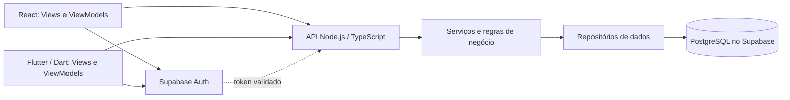

# Hackarum-Yvisalro

> Nome padronizado: **Hackarum-Yvisalro**. O frontend React e a WebAPI TypeScript estão em `frontend/` e `backend/`. A **entrega final do MVP** reúne as 11 telas do protótipo funcionando com dados fictícios, o mapa com rotas em uma planta em escala real e a landing page; veja [Entrega final do MVP](#entrega-final-do-mvp). O aplicativo móvel nativo continua fora desta entrega.

[Detalhamento do frontend](docs/frontend.md) com as 11 imagens do protótipo, a navegação e o comportamento esperado em cada tela.

[Detalhamento geral do projeto](docs/detalhamento-projeto.md) com o estado atual, funcionalidades, arquitetura prevista e pendências. O [guia de Git e GitHub](docs/guia-git.md) explica como atualizar o computador e publicar o trabalho da equipe.

[Base de execução e publicação](docs/base-execucao-sistema.md): arquitetura planejada para acessar o sistema de diferentes computadores, configuração do Supabase e pendências para a entrega final. A hospedagem e a publicação ainda não foram realizadas.

## Entrega final do MVP

Esta seção resume o que foi desenvolvido para a entrega final. Todos os shoppings, lojas, produtos, preços, estoques, distâncias e contas exibidos são **fictícios**.

### Como executar e testar

Com Node.js 24 LTS, na raiz do repositório:

```sh
npm install
npm run dev
```

Abra `http://127.0.0.1:5173`. Sem arquivo `backend/.env` (ou sem `SUPABASE_URL` e `SUPABASE_SECRET_KEY`), o sistema abre em **modo demonstração**:

1. Na tela de login, clique em **Preencher** e depois em **Entrar** (conta fictícia `marina.souza@exemplo.com`).
2. No Início, a oferta próxima aparece após alguns segundos.
3. Em Buscar, digite `fone bluetooth até 300`, toque na seta de rota de um resultado, escolha **Entrada Sul (principal)** e avance com **Próxima**.
4. Explore Desejos, Avise-me, Perfil e os stories (círculos das lojas no Início).
5. A landing page fica em `http://127.0.0.1:5173/sobre`.

### Telas do protótipo funcionando

As 11 telas de `docs/imagens/achei/` foram implementadas em React e funcionam de ponta a ponta no modo demonstração:

| Tela | Endereço | O que funciona |
| --- | --- | --- |
| 01 Login | `/entrar` | Conta lembrada, troca de conta, mostrar senha, preenchimento da conta de demonstração. |
| 02 Cadastro | `/cadastro` | Foto opcional (recortada e reduzida no navegador), validações, medidor de força e sugestão de senha forte. |
| 03 Preferências | `/cadastro/preferencias` | Categorias, produtos desejados em etiquetas, ofertas por e-mail (começa desligado), pular. |
| 04 Recuperação de senha | `/recuperar-senha` | Envio de código de 6 dígitos (exibido na tela; nenhum e-mail é enviado), colar código, reenviar com contagem, nova senha. |
| 05 Início | `/inicio` | Stories das lojas, atalhos "Pra você" com desconto, destaque da lista de desejos com contagem regressiva, recomendações. |
| 06 Busca | `/buscar` | Interpretação de "até 300", filtros (promoção, estoque, tipo), comparação entre lojas, Avise-me para itens esgotados. |
| 07 Story | `/stories?loja=moda-leve` | Avanço automático, toque nas laterais, setas do teclado, pausa, salvar nos desejos, ir até a loja. |
| 08 Desejos | `/desejos` | Queda de preço desde que o item foi salvo, loja mais barata, ordenação, aba Avise-me. |
| 09 Mapa | `/mapa` | Planta com pisos, zoom, arrastar, busca de lojas, lista de lojas, lojas próximas do ponto escolhido. |
| 10 Rota ativa | `/mapa?loja=pixel-house` | Escolha do ponto de partida, instruções passo a passo, troca de piso, anúncios pausados durante a rota. |
| 11 Oferta próxima | `/inicio` | Oferta servida pela API, priorizando categorias de interesse; nunca aparece com rota ativa. |

O Perfil (`/perfil`) permite alterar interesses e ofertas por e-mail, sair e restaurar os dados da demonstração. Contas, desejos e buscas ficam só no navegador (`localStorage`); senhas criadas na demonstração são guardadas apenas como hash.

### Regras de negócio aplicadas

- **Busca:** relevância primeiro e, entre resultados semelhantes, o menor preço; itens sem estoque sempre por último, com "Avise-me quando voltar".
- **Ofertas próximas:** no máximo uma por visita ao Início, descartável com "Agora não" e bloqueada durante uma rota ativa.
- **Comunicação:** ofertas por e-mail só com consentimento explícito, revogável no Perfil.
- **Sem compras no app:** o objetivo é encontrar, comparar e chegar à loja; o usuário pode sair sem comprar.

### Mapa e rotas em escala real

- A demonstração usa a planta de dois pisos do **Shopping Veredas Douradas** (fictício): Térreo e Praça de Alimentação, 206 unidades, entradas, escadas rolantes e corredores.
- As lojas do catálogo do protótipo (Pixel House, Grão Fino, Moda Leve e outras) são posicionadas em unidades da mesma categoria por `backend/scripts/generate-demo-veredas.mjs`, que também calcula a distância de caminhada real a partir da entrada principal. Essas distâncias aparecem na busca, nos stories e na oferta próxima.
- As rotas usam o menor caminho no grafo de corredores. O mapa enquadra automaticamente a área livre da tela: piso inteiro ao abrir, trajeto completo no primeiro passo, trecho atual nos passos seguintes e a loja na chegada.
- Marcadores sobrepostos são omitidos para manter o mapa legível; o destino sempre aparece.

### Modo demonstração e dados

- **Ativação:** `VITE_DEMO_MODE=true` força o modo demonstração e `VITE_DEMO_MODE=false` o desliga (use em produção). Vazio, ele liga quando a API informa que o Supabase não está configurado.
- **API em memória:** sem Supabase, a WebAPI serve `GET /api/v1/mall` e `GET /api/v1/promotions` a partir de `backend/src/infrastructure/demo`. Com Supabase configurado, o fluxo real, incluindo o catálogo da feature 010, continua igual.
- **Migrações novas:**
  - `0021_veredas_douradas_map.sql` cria o shopping fictício com 152 lojas de nomes inventados. Ele substitui a versão anterior da planta, que usava nomes reais de shopping, marcas e ruas, e é criado inativo.
  - `0022_prototype_demo_stores.sql` acrescenta ao Shopping Aurora as lojas e ofertas fictícias das telas.
- **Navegação:** o endereço raiz abre direto o login (ou o Início, com sessão), e a landing page fica em `/sobre`.

### Landing page

A tecnologia sorteada (landing page) foi entregue como página web em `/sobre`, seguindo o roteiro de [landing-pages-canva.md](docs/landing-pages-canva.md) para os dois públicos:

- **Consumidores:** proposta "Encontre o produto, o melhor preço e o caminho até a loja", os três passos (busque, compare, chegue lá), os recursos e uma galeria com capturas reais das telas.
- **Lojistas:** benefícios de publicar catálogo e promoções. O painel da empresa aparece como "em desenvolvimento", sem prometer cadastro.
- **Perguntas frequentes e rodapé:** identificam os dados como fictícios.
- **Visual:** a página segue a linguagem do protótipo e é responsiva. As capturas estão em `frontend/public/landing/`.

### Correções feitas durante a entrega

- O backend reiniciava sem parar em desenvolvimento; agora observa apenas `src` (`--watch-path=src`).
- O endereço correto do frontend é `http://127.0.0.1:5173`: o Vite escuta só nesse endereço e a API confere a origem.
- A detecção do modo demonstração tenta a API algumas vezes antes de desistir, para não cair no fluxo real durante um reinício do backend.

### Limitações conhecidas

- As migrações SQL não foram aplicadas em um projeto Supabase real; o fluxo com Supabase (cadastro, login, e-mails) depende da configuração descrita em [base de execução](docs/base-execucao-sistema.md).
- No banco, o Shopping Veredas Douradas é criado inativo; a planta grande é usada pelo modo demonstração.
- "Reservar item" (tela 10) e o painel da empresa continuam fora do MVP.
- A hospedagem pública ainda não foi configurada.

## Executar a base do projeto

Com Node.js 24 LTS, execute na raiz:

```sh
npm install
npm run dev
```

Frontend: `http://127.0.0.1:5173`. WebAPI: `http://127.0.0.1:3000/api/v1`.
`npm run build` compila os dois projetos. No Windows sem Node.js, use o bootstrap e o
wrapper descritos no [guia de desenvolvimento](docs/desenvolvimento.md).
Arquitetura e escopo desta inicialização estão na [feature 003](specs/003-base-webapi-frontend/plan.md).

## Decisões confirmadas pela equipe

Em **13/11/2026**, após a análise dos pontos de discussão da branch `VictorXavierSL-patch-1-dev`, foram confirmadas as seguintes escolhas:

| Parte | Decisão |
| --- | --- |
| Frontend web e painel empresarial | Manter **React**. |
| Banco de dados do MVP | **PostgreSQL no Supabase**. |
| Backend | **TypeScript**, mantendo Node.js como ambiente de execução previsto. |
| Telas do protótipo | Manter as **11 telas no canvas de design atual**, com as imagens exportadas como referência na documentação. |

Essas decisões orientam a implementação ainda pendente. O canvas de design é o material de referência das telas. O formato, a ferramenta, a quantidade e as finalidades das landing pages continuam a ser definidos pela equipe; o roteiro em slides do Canva permanece como proposta.

## Proposta e estrutura inicial das telas

Criar um aplicativo para dispositivos móveis que ajude pessoas a descobrir lojas em um shopping, buscar produtos, comparar preços e encontrar promoções. Uma representação de mapa com aparência 3D deverá mostrar lojas e trajetos simulados. Nomes de lojas, produtos e shopping utilizados na demonstração serão fictícios.

O público principal são consumidores que desejam encontrar produtos e preços em diferentes lojas. O catálogo funcionará como uma vitrine de marketplace; compras e pagamentos não fazem parte do escopo atualmente definido.

O projeto atende ao tema **03. Descoberta de produtos, lojas e promoções**, registrado na branch da equipe. O visitante procura um produto, compara ofertas, identifica a loja e consulta um trajeto interno simulado. Lojistas usam um painel para publicar seus próprios produtos. As [11 telas documentadas](docs/frontend.md) representam o consumidor; painel empresarial, estados de erro e demais lacunas estão identificados nesse documento.

Os seis títulos desta entrega organizam os materiais do mesmo projeto. **Achei** é o nome impresso nas imagens antigas e **Vitrine Perto** permanece em caminhos históricos; ambos se referem ao Hackarum-Yvisalro.

## Primeira entrega

A imagem fornecida pela equipe solicita planejamento técnico inicial: proposta e estrutura inicial de telas; documentação; linguagem escolhida; arquitetura; plataformas e tecnologias; e descrição da incorporação da tecnologia ou prática sorteada. Trata-se de uma entrega de planejamento, anterior ao MVP. A imagem informa sexta-feira, 13/11, até 12h; confirme o ano e o horário com a disciplina.

Este README reúne a proposta inicial. Já existem 11 imagens de protótipo e uma especificação em rascunho; os fluxos ausentes, o plano técnico e os contratos ainda precisam ser preparados e revisados pela equipe.

## Documentação inicial do projeto

| Material | Evidência |
| --- | --- |
| Proposta, telas e comportamento | Este README e [frontend](docs/frontend.md). |
| Regras do produto | [Especificação funcional](specs/001-vitrine-perto/spec.md). |
| Revisão da entrega inicial | [Feature 002](specs/002-planejamento-hackarum-yvisalro/spec.md) e [checklist](specs/002-planejamento-hackarum-yvisalro/checklists/requirements.md). |
| Arquitetura e tecnologias | Seções próprias abaixo e [detalhamento técnico](docs/detalhamento-projeto.md). |
| Apresentação da prática sorteada | [Rascunho de roteiro em slides do Canva](docs/landing-pages-canva.md); formato a confirmar. |
| Conferência das versões e seis itens | [Relatório de conformidade](docs/revisao-conformidade.md). |
| Organização e versionamento | [Entrega](docs/entrega-e-proximos-passos.md) e [guia de Git](docs/guia-git.md). |

## Funcionalidades planejadas para o MVP

- Cadastro com nome, email, senha e imagem opcional; definição de interesses e permissão para receber publicidade por email.
- Autenticação real com Supabase, recuperação de senha por email, login com Google e Apple e suporte ao preenchimento automático de senhas. O envio efetivo de campanhas publicitárias ainda precisa ser definido.
- Tela inicial com pesquisa, categorias, ofertas em destaque, stories promocionais e carrosséis de produtos.
- Busca por texto, categorias e sinônimos, filtros de tipo e preço, produtos semelhantes e comparação de ofertas do mesmo produto em lojas diferentes. Exibir a loja identificada abaixo do produto.
- Priorizar disponíveis por relevância e, entre semelhantes, menor preço; produtos fora de estoque aparecem por último, com opção de aviso de reposição por email quando houver retorno ao estoque.
- Lista de desejos e recomendações baseadas em interesses e interações. A origem de histórico de compras ainda precisa ser definida.
- Geolocalização para apoiar a descoberta de lojas próximas; mapa fictício com aparência 3D, ícones de sacola que se tornam logos ao aproximar e indicação de trajeto simulado até a loja.
- Pop-ups de promoções próximas; não exibi-los enquanto um trajeto estiver ativo.
- Landing pages com conteúdos distintos para consumidores e lojistas. Há uma proposta de roteiro em slides do Canva; formato, ferramenta, quantidade final e eventual publicação como site dependem da revisão da equipe.

Promoções e preços de demonstração devem ser identificáveis como fictícios; quando houver desconto, preço anterior e preço promocional devem ser coerentes.

## Melhorias e ideias para o produto

As ideias abaixo foram escolhidas para compor o planejamento. **Prioridade** indica a importância sugerida para o usuário; **dificuldade** é uma estimativa inicial do esforço de implementação, sujeita à revisão da equipe. Recursos de prioridade alta são candidatos ao MVP; os demais podem ser incluídos conforme o prazo e a capacidade da equipe. Nenhum deles está implementado.

### 1. Informações claras sobre cada oferta

**Prioridade:** alta · **Dificuldade:** baixa

Cada card ou detalhe de promoção poderá apresentar preço anterior, preço atual, período de validade e data da última atualização, quando essas informações existirem. Exemplo fictício: um tênis anunciado por R$ 150, antes R$ 200, com indicação de validade da oferta. Se algum dado não estiver disponível, a interface deve deixar isso claro em vez de inventá-lo.

**Benefício:** o usuário entende quanto pagará e consegue avaliar se a informação é recente. No protótipo, os valores e descontos serão identificados como demonstrativos.

### 2. Comparação de preços entre lojas

**Prioridade:** alta · **Dificuldade:** média

Na página de um produto, reunir as ofertas das lojas que vendem o mesmo item, mostrando preço, promoção, disponibilidade e localização de cada loja. O usuário poderá escolher uma oferta e abrir a loja ou iniciar o trajeto simulado. A equipe ainda deve definir como reconhecer produtos equivalentes e ordenar as ofertas.

**Benefício:** a pessoa encontra rapidamente onde o produto custa menos, sem precisar abrir várias páginas. A comparação amplia a funcionalidade já prevista na busca.

### 3. Seleção manual do shopping

**Prioridade:** alta · **Dificuldade:** baixa

Além de permitir a descoberta com geolocalização, o aplicativo poderá apresentar uma lista de shoppings para seleção manual. Essa alternativa estará disponível quando a pessoa não quiser fornecer sua localização ou quando o recurso não estiver disponível.

**Benefício:** o usuário continua acessando produtos, lojas e o mapa mesmo sem compartilhar a localização.

### 4. Página de detalhes da loja

**Prioridade:** alta · **Dificuldade:** baixa

Cada loja terá uma página com nome, logo, descrição, horário de funcionamento, posição no shopping e ofertas disponíveis, quando esses dados existirem. A página também dará acesso ao mapa e ao trajeto simulado. Nomes e informações utilizados na demonstração serão fictícios.

**Benefício:** o usuário conhece a loja e encontra outras ofertas relacionadas antes de decidir visitá-la.

### 5. Preferências e controle de notificações

**Prioridade:** alta · **Dificuldade:** média

Uma área de preferências permitirá escolher quais comunicações deseja receber, como avisos de reposição, queda de preço e promoções. A autorização para publicidade por email deve ser apresentada de forma clara e poderá ser alterada pelo usuário. Alertas solicitados estão previstos por email quando houver reposição ou o preço desejado for atingido; serviço de envio e frequência promocional ainda serão definidos.

**Benefício:** reduz mensagens indesejadas e permite que cada pessoa receba informações relevantes para seus interesses.

### 6. Busca que ajuda a corrigir termos

**Prioridade:** média · **Dificuldade:** média

Além da busca por nome, categoria e sinônimos, a interface poderá sugerir uma palavra próxima quando não encontrar resultados ou identificar uma possível digitação incorreta. Por exemplo, uma busca por “têns” poderia sugerir “tênis”. Quando não houver sugestão adequada, deve apresentar uma mensagem clara e permitir ajustar os filtros.

**Benefício:** diminui buscas sem resultado e ajuda quem não sabe o nome exato do produto.

### 7. Lista de lojas como alternativa ao mapa

**Prioridade:** alta · **Dificuldade:** baixa

Junto ao mapa, disponibilizar uma lista de lojas que possa ser organizada ou filtrada por andar e categoria, desde que essas informações estejam cadastradas. Cada item levará aos detalhes da loja e à opção de trajeto. Os elementos da lista e do mapa devem ter identificação textual adequada para recursos de acessibilidade.

**Benefício:** facilita a descoberta para quem prefere texto, usa leitor de tela ou tem dificuldade para interpretar o mapa.

### 8. Escolha do ponto inicial do trajeto

**Prioridade:** alta · **Dificuldade:** média

Antes de exibir o trajeto interno simulado, a pessoa poderá escolher um ponto conhecido do shopping, como uma entrada ou a praça de alimentação. O caminho será desenhado entre esse ponto e a loja selecionada no mapa fictício.

**Benefício:** torna o trajeto mais compreensível sem presumir que a geolocalização do dispositivo identifica a posição exata dentro do shopping.

### 9. Alerta de preço desejado

**Prioridade:** média · **Dificuldade:** média

Na lista de desejos, o usuário poderá informar quanto pretende pagar por um produto. O sistema poderá registrar essa preferência e avisar quando uma oferta cadastrada atingir o valor. A equipe deve definir se o aviso será enviado de verdade no MVP e qual será o canal.

**Benefício:** ajuda a acompanhar uma oferta sem precisar pesquisar o produto repetidamente.

### 10. Lista de compras por shopping

**Prioridade:** média · **Dificuldade:** média

Permitir agrupar itens desejados em uma lista associada a um shopping e consultar as lojas que possuem ofertas para cada item. A lista poderá ser organizada antes de uma visita, com indicação de disponibilidade conforme os dados cadastrados.

**Benefício:** facilita o planejamento de compras com vários produtos e evita repetir buscas durante a visita.

### 11. Roteiro para visitar várias lojas

**Prioridade:** média · **Dificuldade:** alta

A partir dos produtos de uma lista de compras, sugerir uma sequência de lojas e representar o percurso entre elas. A pessoa poderá rever as lojas selecionadas e escolher o ponto inicial. No protótipo, o roteiro usará locais e caminhos fictícios; a regra para escolher a sequência precisa ser definida.

**Benefício:** diferencia o aplicativo ao ajudar a planejar uma visita completa, não apenas o caminho até uma única loja.

### 12. Comparação por unidade de medida

**Prioridade:** média · **Dificuldade:** média

Quando os dados do produto permitirem, mostrar também o preço por quilo, litro ou unidade. Por exemplo, além do preço total de duas embalagens, apresentar o valor por litro para que possam ser comparadas. Se quantidade ou unidade estiverem ausentes, não apresentar um cálculo estimado como se fosse certo.

**Benefício:** permite comparar embalagens de tamanhos diferentes e identificar a oferta mais econômica por quantidade.

### 13. Histórico de preços

**Prioridade:** baixa · **Dificuldade:** alta

Mostrar os preços anteriores de uma oferta ao longo do tempo, com as respectivas datas, quando houver dados suficientes. A demonstração poderá usar histórico fictício identificado como tal. A equipe deve definir quanto histórico será guardado e como os preços serão atualizados.

**Benefício:** oferece contexto para avaliar uma promoção e acompanhar variações ao longo do tempo.

### 14. Compartilhamento de ofertas

**Prioridade:** média · **Dificuldade:** média

Permitir compartilhar um link ou resumo contendo produto, preço, loja e identificação da oferta. O formato e o destino do link dependem da definição das landing pages e de como será o acesso às ofertas fora do aplicativo.

**Benefício:** facilita enviar uma descoberta a amigos e familiares e pode ajudar a divulgar o projeto.

### Sugestão de ordem de trabalho

Para um primeiro recorte, a equipe pode priorizar informações claras das ofertas, comparação entre lojas, seleção manual de shopping, página da loja, lista acessível e ponto inicial da rota. Controle de notificações também tem prioridade alta, mas o envio real depende de uma decisão sobre canais e escopo. As demais ideias podem ser distribuídas nas próximas etapas conforme prazo e esforço.

## Telas propostas

1. **Boas-vindas e autenticação:** login, cadastro, recuperação de senha e acesso com Google/Apple.
2. **Preferências:** interesses, produtos desejados e autorização para publicidade por email.
3. **Início:** pesquisa, atalhos de categoria, stories, destaques e carrossel.
4. **Busca:** campo de texto, filtros, resultados com preço, promoção, disponibilidade e loja.
5. **Produto:** detalhes, comparação entre lojas, semelhantes e ações de lista de desejos ou aviso de reposição.
6. **Loja:** dados da loja, ofertas e acesso ao trajeto.
7. **Mapa e lista de lojas:** escolha do shopping e do ponto inicial, localização das lojas, aproximação e rota simulada.
8. **Lista de desejos e compras:** produtos salvos, preço desejado, agrupamento por shopping e roteiro com várias lojas.
9. **Perfil e notificações:** dados da conta, preferências e controles de comunicação.
10. **Landing pages:** conteúdos diferentes para apresentar o MVP; roteiro inicial proposto para consumidores e lojistas, com formato, ferramenta e quantidade final a confirmar.
11. **Painel da empresa:** cadastro e publicação imediata de produtos, preços, promoções e estoque pela própria empresa, com acesso limitado aos seus dados.

Os fluxos devem contemplar estados sem resultados, sem conexão, carregamento, erro e permissão de localização negada; o comportamento detalhado ainda precisa ser especificado.

## Linguagem de programação escolhida

- **TypeScript:** linguagem confirmada para o backend Node.js; também proposta para o frontend React para compartilhar os tipos dos contratos. O build e a versão serão definidos no plano técnico.
- **Dart:** linguagem do aplicativo Flutter.
- **SQL:** definição e consulta dos dados no PostgreSQL.

Node.js é o ambiente de execução; React e Flutter são ferramentas de interface. As telas permanecem no canvas de design atual. Canva é uma ferramenta proposta para apresentar as landing pages; o formato final ainda será definido. Referências: [Node.js](https://nodejs.org/en/about), [React](https://react.dev/) e [arquitetura Flutter](https://docs.flutter.dev/app-architecture/guide).

## Arquitetura proposta

Adotar **MVVM (Model–View–ViewModel)** nas interfaces: a View apresenta a tela, o ViewModel mantém estado e ações, e Models representam os dados. Repositórios e serviços cuidam do acesso à API. No React, componentes serão as Views e hooks ou módulos de estado exercerão o papel de ViewModels; essa é a organização proposta para o projeto. A documentação oficial de Flutter apresenta essa [separação de responsabilidades](https://docs.flutter.dev/app-architecture/guide).



A API recebe requisições HTTPS/JSON, valida a identidade e a autorização da empresa e aplica as regras de catálogo, ofertas, desejos e alertas. As credenciais do banco ficam no servidor. O backend seguirá camadas de entrada, serviços e persistência; MVVM organiza as interfaces. O canvas de design e as imagens exportadas representam as telas e os fluxos planejados.

**Decisão confirmada em 13/11/2026:** PostgreSQL no Supabase será o banco do MVP, mantendo Supabase para dados e identidade. O registro anterior de **MySQL como alternativa documentada** permanece fora da operação do MVP, sem segundo banco operacional, replicação ou escrita dupla. Supabase oferece [um banco PostgreSQL](https://supabase.com/docs/guides/database/overview).

## Plataforma e tecnologias adotadas

| Parte | Escolha | Papel e situação |
| --- | --- | --- |
| Aplicativo móvel | Flutter / Dart | Interface com MVVM; planejada, sem código da aplicação. |
| Frontend web e painel empresarial | React confirmado; TypeScript proposto para a interface | Cadastro e preferências implementados em JavaScript/JSX com MVVM; configuração real e demais fluxos/painel pendentes. |
| Backend | Node.js / TypeScript / Express 5 | WebAPI com cadastro, sessão, retomada, preferências e foto privada; serviços reais e hospedagem pendentes. |
| Banco principal | PostgreSQL no Supabase | Escolha confirmada para persistência do MVP; integração ainda não configurada. |
| Identidade | Supabase Auth | Cadastro, confirmação e entrada e-mail/senha implementados no código; configuração real pendente. Recuperação e provedores sociais continuam previstos. |
| Banco alternativo | MySQL | Alternativa documentada para avaliação futura; fora da operação do primeiro MVP. |
| Protótipos das telas | Canvas de design atual | Manter as 11 telas existentes e suas imagens exportadas como referência de UX. |
| Landing pages | Formato a decidir | Rascunho de roteiro em slides do Canva; ferramenta, quantidade e finalidades a confirmar. |
| Mapa e dados | Mapa fictício e geolocalização | Rotas simuladas e localização do dispositivo prevista; coordenadas e implementação pendentes. |
| Processo | Git, GitHub e Spec Kit | Versionamento e organização dos requisitos; já disponíveis. |

A hospedagem da aplicação web, da API e de eventuais landing pages publicadas será escolhida no plano técnico; não há implantação configurada.

## Descrição de como a tecnologia ou prática sorteada será incorporada à solução

A tecnologia sorteada é **landing page**, conforme o registro da equipe na [branch verificada](https://github.com/leonardodavi9274-byte/HackaRun-2026-projeto-Yvisalro-13-/commit/8bcbfeb5889c9be843ef8917be56fb7ebbca67ae). Na entrega final, ela foi implementada como página web em `/sobre`, com seções para consumidores e lojistas; detalhes em [Landing page](#landing-page). A decisão de manter as telas no canvas de design atual se refere ao protótipo da aplicação.

O [roteiro](docs/landing-pages-canva.md) propõe uma página para o consumidor (buscar, comparar e encontrar a loja) e outra para o lojista (publicar produtos e promoções). Cada página tem problema, benefício, referência visual e chamada para ação ilustrativa. O material deve identificar os dados fictícios e as funcionalidades futuras. Uma página de oferta compartilhada poderá ser acrescentada como evolução.

Se a proposta em slides for aprovada, a evidência final deverá incluir o link de visualização e uma exportação PDF. Esses materiais ainda não foram produzidos. A equipe deve conferir se a avaliação exige uma página web publicada e definir as evidências conforme o formato aprovado.

## Estrutura preliminar de dados

- **Usuário:** identidade, nome, email, foto opcional, preferências e consentimento de comunicação.
- **Shopping e loja:** nome fictício, localização, identificação visual e posição no mapa.
- **Produto e categoria:** nome, descrição, categoria e termos de busca relacionados.
- **Oferta:** produto, loja, preço, desconto, vigência e disponibilidade.
- **Lista de desejos e pedidos de aviso:** vínculo entre usuário e produto; canal de notificação a definir.
- **Mapa e rota:** pontos e conexões fictícios usados para representar o caminho interno.
- **Listas de compras e preferências de preço:** produtos agrupados por shopping e valores de interesse definidos pelo usuário.
- **Histórico de preços:** registros de valor e data por oferta, quando disponíveis; quantidade e período de retenção a definir.

Esta é uma proposta conceitual, não um esquema de banco final.

## Pontos para decidir com a equipe

1. Definir formato, ferramenta, quantidade e finalidade das landing pages. O rascunho de roteiro no Canva propõe consumidor e lojista como públicos iniciais.
2. As lojas serão fictícias e inspiradas em Palmas; quais coordenadas serão usadas na demonstração de proximidade?
3. A localização indisponível exibirá mensagem de erro e seleção manual; o ponto inicial interno será escolhido no mapa.
4. Listas de desejos e preferências serão sincronizadas por usuário. Avisos solicitados serão enviados por email quando houver reposição ou quando o preço desejado for atingido; a frequência das mensagens promocionais ainda precisa ser definida.
5. A busca deverá encontrar variantes relacionadas, sem tratá-las automaticamente como produtos idênticos. Resultados disponíveis serão ordenados por relevância e, entre semelhantes, menor preço; itens sem estoque virão por último. A equivalência exata ainda precisa ser detalhada.
6. A prática sorteada é landing page. Confirmar com a disciplina se uma apresentação atende à entrega ou se será exigido site publicado.
7. A plataforma será web e aplicativo móvel; a equipe de TI do shopping é a responsável indicada. Cronograma, hospedagem do backend e limites dos serviços permanecem a definir.

## Próximos passos

1. Validar esta proposta e responder aos pontos em aberto.
2. Preparar wireframes e fluxo das telas para a primeira entrega.
3. Usar as especificações registradas para elaborar plano, modelo de dados, contratos e tarefas de implementação com Spec Kit.
4. Gerar tarefas, incluindo autenticação, backend, banco, geolocalização e landing pages, e revisar a cobertura antes da implementação.
5. Manter o [repositório GitHub](https://github.com/leonardodavi9274-byte/HackaRun-2026-projeto-Yvisalro-13-) atualizado e integrar o trabalho da equipe por pull requests.

## Situação atual

**Entrega final do MVP:** telas do protótipo funcionando em modo demonstração, mapa com rotas na planta em escala real e landing page, conforme [Entrega final do MVP](#entrega-final-do-mvp). Os builds de frontend e backend passam; o fluxo foi verificado no navegador em tamanho de celular e de computador.

Histórico das etapas anteriores:

A [feature 004](specs/004-cadastro-preferencias/plan.md) tem cadastro em dois passos, interesses,
publicidade opcional/alterável, entrada por e-mail/senha, confirmação, retomada e foto privada
implementados no código. A página de apresentação e a saúde da base foram preservadas.

Em 2026-11-14, os builds de frontend e backend passaram. Supabase, SMTP, bucket e documentos
legais ainda precisam de configuração real; as 14 migrações estão em backend/supabase/migrations.
Nenhuma migração remota, criação de conta ou envio de e-mail foi executado nesta entrega.

As demais funcionalidades da vitrine continuam pendentes. O fluxo permanece sem testes.
Consulte o [guia da feature](specs/004-cadastro-preferencias/quickstart.md) e o
[acompanhamento das tarefas](specs/004-cadastro-preferencias/tasks.md).
