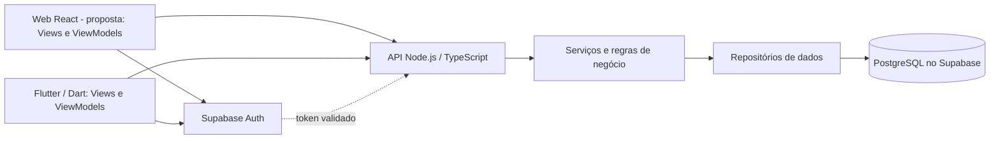

# Hackarum-Yvisalro — planejamento inicial

> Nome padronizado: **Hackarum-Yvisalro**. Primeira entrega acadêmica de planejamento. Aplicativo, backend, frontend web e landing pages ainda não foram implementados ou produzidos.

[Detalhamento do frontend](docs/frontend.md) com as 11 imagens do protótipo, a navegação e o comportamento esperado em cada tela.

[Detalhamento geral do projeto](docs/detalhamento-projeto.md) com o estado atual, funcionalidades, arquitetura prevista e pendências. O [guia de Git e GitHub](docs/guia-git.md) explica como atualizar o computador e publicar o trabalho da equipe.

## Proposta e estrutura inicial das telas

Criar um aplicativo para dispositivos móveis que ajude pessoas a descobrir lojas em um shopping, buscar produtos, comparar preços e encontrar promoções. Uma representação de mapa com aparência 3D deverá mostrar lojas e trajetos simulados. Nomes de lojas, produtos e shopping utilizados na demonstração serão fictícios.

O público principal são consumidores que desejam encontrar produtos e preços em diferentes lojas. O catálogo funcionará como uma vitrine de marketplace; compras e pagamentos não fazem parte do escopo atualmente definido.

Lojistas usam um painel para publicar seus próprios produtos. As [11 telas documentadas](docs/frontend.md) representam o consumidor; o [índice do protótipo](specs/001-vitrine-perto/prototipo/README.md) liga cada tela às histórias e aos requisitos e lista o painel empresarial, os estados de erro e as demais lacunas.

O protótipo visual se chama **hackarum-yvisalro-telasprototipo**. As imagens ainda exibem o logotipo **achei**, nome usado quando foram desenhadas, e **Vitrine Perto** permanece no caminho histórico da especificação; todos se referem ao Hackarum-Yvisalro.

### Tema do desafio

**03. Descoberta de produtos, lojas e promoções**

- **Contexto:** um visitante chega ao shopping procurando um produto específico, como uma roupa, um tênis, um perfume ou um eletrônico.
- **Problemática:** o consumidor pode não saber quais estabelecimentos comercializam o produto desejado, onde encontrá-lo, quais opções estão disponíveis ou onde existem condições comerciais mais interessantes.
- **Objetivo:** facilitar a descoberta de produtos, estabelecimentos e oportunidades de compra dentro do shopping.

#### Como a proposta responde ao tema

| Dúvida do consumidor | Resposta da solução | Requisitos |
| --- | --- | --- |
| Quais lojas vendem o produto? | Busca por texto, categoria e sinônimos, com a loja identificada em cada resultado. | FR-003, FR-004 |
| Onde encontrá-lo? | Mapa interno com aparência 3D, lista de lojas por andar e categoria e rota simulada a partir de um ponto escolhido. | FR-007, FR-008 |
| Quais opções estão disponíveis? | Disponibilidade em cada oferta, itens esgotados por último, variantes relacionadas e aviso de reposição. | FR-004, FR-005, FR-010 |
| Onde há condições mais interessantes? | Comparação de preço entre lojas, promoções e stories, ofertas próximas e alerta de preço desejado. | FR-005, FR-009, FR-010, FR-011 |

## Primeira entrega

A imagem fornecida pela equipe solicita planejamento técnico inicial: proposta e estrutura inicial de telas; documentação; linguagem escolhida; arquitetura; plataformas e tecnologias; e descrição da incorporação da tecnologia ou prática sorteada. Trata-se de uma entrega de planejamento, anterior ao MVP. A imagem informa sexta-feira, 13/11, até 12h; confirme o ano e o horário com a disciplina.

Este README reúne a proposta inicial. Já existem 11 imagens de protótipo e uma especificação em rascunho; os fluxos ausentes, o plano técnico e os contratos ainda precisam ser preparados e revisados pela equipe.

## Documentação inicial do projeto

| Material | Evidência |
| --- | --- |
| Proposta, telas e comportamento | Este README e [frontend](docs/frontend.md). |
| Regras do produto | [Especificação funcional](specs/001-vitrine-perto/spec.md). |
| Revisão da entrega inicial | [Feature 002](specs/002-planejamento-hackarum-yvisalro/spec.md) e [checklist](specs/002-planejamento-hackarum-yvisalro/checklists/requirements.md). |
| Arquitetura e tecnologias | Seções próprias abaixo e [detalhamento técnico](docs/detalhamento-projeto.md). |
| Apresentação da prática sorteada | [Roteiro dos slides no Canva](docs/landing-pages-canva.md). |
| Conferência das versões e seis itens | [Relatório de conformidade](docs/revisao-conformidade.md). |
| Organização e versionamento | [Entrega](docs/entrega-e-proximos-passos.md) e [guia de Git](docs/guia-git.md). |

## Funcionalidades planejadas para o MVP

- Cadastro com nome, email, senha e imagem opcional; definição de interesses e permissão para receber publicidade por email.
- Autenticação real com Supabase, recuperação de senha por email, login com Google e Apple e suporte ao preenchimento automático de senhas. O envio efetivo de campanhas publicitárias ainda precisa ser definido.
- Tela inicial com pesquisa, categorias, ofertas em destaque, stories promocionais e carrosséis de produtos.
- Busca por texto, categorias e sinônimos, filtros de tipo e preço, produtos semelhantes e comparação de ofertas do mesmo produto em lojas diferentes. Exibir a loja identificada abaixo do produto.
- Priorizar disponíveis por relevância e, entre semelhantes, menor preço; produtos fora de estoque aparecem por último, com opção de aviso de reposição por email quando houver retorno ao estoque.
- Lista de desejos e recomendações baseadas em interesses e interações. A origem de histórico de compras ainda precisa ser definida.
- Geolocalização para apoiar a descoberta de lojas próximas; mapa fictício com aparência 3D, ícones de sacola que se tornam logos ao aproximar e indicação de trajeto simulado até a loja.
- Pop-ups de promoções próximas; não exibi-los enquanto um trajeto estiver ativo.
- Landing pages apresentadas em slides do Canva, com roteiros distintos para consumidores e lojistas. São demonstrações de apresentação; quantidade final e eventual publicação como site dependem da revisão da equipe.

Promoções e preços de demonstração devem ser identificáveis como fictícios; quando houver desconto, preço anterior e preço promocional devem ser coerentes.

## Melhorias e ideias para o produto

As ideias abaixo foram escolhidas para compor o planejamento. **Prioridade** indica a importância sugerida para o usuário; **dificuldade** é uma estimativa inicial do esforço de implementação, sujeita à revisão da equipe. Recursos de prioridade alta são candidatos ao MVP; os demais podem ser incluídos conforme o prazo e a capacidade da equipe. Nenhum deles está implementado.

### 1. Informações claras sobre cada oferta

**Prioridade:** alta · **Dificuldade:** baixa

Cada card ou detalhe de promoção poderá apresentar preço anterior, preço atual, período de validade e data da última atualização, quando essas informações existirem. Exemplo fictício: um tênis anunciado por R$ 150, antes R$ 200, com indicação de validade da oferta. Se algum dado não estiver disponível, a interface deve deixar isso claro em vez de inventá-lo.

**Benefício:** o usuário entende quanto pagará e consegue avaliar se a informação é recente. No protótipo, os valores e descontos serão identificados como demonstrativos.

### 2. Comparação de preços entre lojas

**Prioridade:** alta · **Dificuldade:** média

Na página de um produto, reunir as ofertas das lojas que vendem o mesmo item, mostrando preço, promoção, disponibilidade e localização de cada loja. O usuário poderá escolher uma oferta e abrir a loja ou iniciar o trajeto simulado. A equipe ainda deve definir como reconhecer produtos equivalentes e ordenar as ofertas.

**Benefício:** a pessoa encontra rapidamente onde o produto custa menos, sem precisar abrir várias páginas. A comparação amplia a funcionalidade já prevista na busca.

### 3. Seleção manual do shopping

**Prioridade:** alta · **Dificuldade:** baixa

Além de permitir a descoberta com geolocalização, o aplicativo poderá apresentar uma lista de shoppings para seleção manual. Essa alternativa estará disponível quando a pessoa não quiser fornecer sua localização ou quando o recurso não estiver disponível.

**Benefício:** o usuário continua acessando produtos, lojas e o mapa mesmo sem compartilhar a localização.

### 4. Página de detalhes da loja

**Prioridade:** alta · **Dificuldade:** baixa

Cada loja terá uma página com nome, logo, descrição, horário de funcionamento, posição no shopping e ofertas disponíveis, quando esses dados existirem. A página também dará acesso ao mapa e ao trajeto simulado. Nomes e informações utilizados na demonstração serão fictícios.

**Benefício:** o usuário conhece a loja e encontra outras ofertas relacionadas antes de decidir visitá-la.

### 5. Preferências e controle de notificações

**Prioridade:** alta · **Dificuldade:** média

Uma área de preferências permitirá escolher quais comunicações deseja receber, como avisos de reposição, queda de preço e promoções. A autorização para publicidade por email deve ser apresentada de forma clara e poderá ser alterada pelo usuário. Alertas solicitados estão previstos por email quando houver reposição ou o preço desejado for atingido; serviço de envio e frequência promocional ainda serão definidos.

**Benefício:** reduz mensagens indesejadas e permite que cada pessoa receba informações relevantes para seus interesses.

### 6. Busca que ajuda a corrigir termos

**Prioridade:** média · **Dificuldade:** média

Além da busca por nome, categoria e sinônimos, a interface poderá sugerir uma palavra próxima quando não encontrar resultados ou identificar uma possível digitação incorreta. Por exemplo, uma busca por “têns” poderia sugerir “tênis”. Quando não houver sugestão adequada, deve apresentar uma mensagem clara e permitir ajustar os filtros.

**Benefício:** diminui buscas sem resultado e ajuda quem não sabe o nome exato do produto.

### 7. Lista de lojas como alternativa ao mapa

**Prioridade:** alta · **Dificuldade:** baixa

Junto ao mapa, disponibilizar uma lista de lojas que possa ser organizada ou filtrada por andar e categoria, desde que essas informações estejam cadastradas. Cada item levará aos detalhes da loja e à opção de trajeto. Os elementos da lista e do mapa devem ter identificação textual adequada para recursos de acessibilidade.

**Benefício:** facilita a descoberta para quem prefere texto, usa leitor de tela ou tem dificuldade para interpretar o mapa.

### 8. Escolha do ponto inicial do trajeto

**Prioridade:** alta · **Dificuldade:** média

Antes de exibir o trajeto interno simulado, a pessoa poderá escolher um ponto conhecido do shopping, como uma entrada ou a praça de alimentação. O caminho será desenhado entre esse ponto e a loja selecionada no mapa fictício.

**Benefício:** torna o trajeto mais compreensível sem presumir que a geolocalização do dispositivo identifica a posição exata dentro do shopping.

### 9. Alerta de preço desejado

**Prioridade:** média · **Dificuldade:** média

Na lista de desejos, o usuário poderá informar quanto pretende pagar por um produto. O sistema poderá registrar essa preferência e avisar quando uma oferta cadastrada atingir o valor. A equipe deve definir se o aviso será enviado de verdade no MVP e qual será o canal.

**Benefício:** ajuda a acompanhar uma oferta sem precisar pesquisar o produto repetidamente.

### 10. Lista de compras por shopping

**Prioridade:** média · **Dificuldade:** média

Permitir agrupar itens desejados em uma lista associada a um shopping e consultar as lojas que possuem ofertas para cada item. A lista poderá ser organizada antes de uma visita, com indicação de disponibilidade conforme os dados cadastrados.

**Benefício:** facilita o planejamento de compras com vários produtos e evita repetir buscas durante a visita.

### 11. Roteiro para visitar várias lojas

**Prioridade:** média · **Dificuldade:** alta

A partir dos produtos de uma lista de compras, sugerir uma sequência de lojas e representar o percurso entre elas. A pessoa poderá rever as lojas selecionadas e escolher o ponto inicial. No protótipo, o roteiro usará locais e caminhos fictícios; a regra para escolher a sequência precisa ser definida.

**Benefício:** diferencia o aplicativo ao ajudar a planejar uma visita completa, não apenas o caminho até uma única loja.

### 12. Comparação por unidade de medida

**Prioridade:** média · **Dificuldade:** média

Quando os dados do produto permitirem, mostrar também o preço por quilo, litro ou unidade. Por exemplo, além do preço total de duas embalagens, apresentar o valor por litro para que possam ser comparadas. Se quantidade ou unidade estiverem ausentes, não apresentar um cálculo estimado como se fosse certo.

**Benefício:** permite comparar embalagens de tamanhos diferentes e identificar a oferta mais econômica por quantidade.

### 13. Histórico de preços

**Prioridade:** baixa · **Dificuldade:** alta

Mostrar os preços anteriores de uma oferta ao longo do tempo, com as respectivas datas, quando houver dados suficientes. A demonstração poderá usar histórico fictício identificado como tal. A equipe deve definir quanto histórico será guardado e como os preços serão atualizados.

**Benefício:** oferece contexto para avaliar uma promoção e acompanhar variações ao longo do tempo.

### 14. Compartilhamento de ofertas

**Prioridade:** média · **Dificuldade:** média

Permitir compartilhar um link ou resumo contendo produto, preço, loja e identificação da oferta. O formato e o destino do link dependem da definição das landing pages e de como será o acesso às ofertas fora do aplicativo.

**Benefício:** facilita enviar uma descoberta a amigos e familiares e pode ajudar a divulgar o projeto.

### Sugestão de ordem de trabalho

Para um primeiro recorte, a equipe pode priorizar informações claras das ofertas, comparação entre lojas, seleção manual de shopping, página da loja, lista acessível e ponto inicial da rota. Controle de notificações também tem prioridade alta, mas o envio real depende de uma decisão sobre canais e escopo. As demais ideias podem ser distribuídas nas próximas etapas conforme prazo e esforço.

## Telas propostas

1. **Boas-vindas e autenticação:** login, cadastro, recuperação de senha e acesso com Google/Apple.
2. **Preferências:** interesses, produtos desejados e autorização para publicidade por email.
3. **Início:** pesquisa, atalhos de categoria, stories, destaques e carrossel.
4. **Busca:** campo de texto, filtros, resultados com preço, promoção, disponibilidade e loja.
5. **Produto:** detalhes, comparação entre lojas, semelhantes e ações de lista de desejos ou aviso de reposição.
6. **Loja:** dados da loja, ofertas e acesso ao trajeto.
7. **Mapa e lista de lojas:** escolha do shopping e do ponto inicial, localização das lojas, aproximação e rota simulada.
8. **Lista de desejos e compras:** produtos salvos, preço desejado, agrupamento por shopping e roteiro com várias lojas.
9. **Perfil e notificações:** dados da conta, preferências e controles de comunicação.
10. **Landing pages:** páginas com conteúdos diferentes para apresentar o MVP; formato, quantidade e finalidades a decidir pela equipe.
11. **Painel da empresa:** cadastro e publicação imediata de produtos, preços, promoções e estoque pela própria empresa, com acesso limitado aos seus dados.

Os fluxos devem contemplar estados sem resultados, sem conexão, carregamento, erro e permissão de localização negada; o comportamento detalhado ainda precisa ser especificado.

## Linguagem de programação escolhida

- **TypeScript:** linguagem do backend Node.js. Se o frontend web em React for confirmado pela equipe, também será usado nele para compartilhar os tipos dos contratos. O build e a versão serão definidos no plano técnico.
- **Dart:** linguagem do aplicativo Flutter.
- **SQL:** definição e consulta dos dados no PostgreSQL.

Node.js é o ambiente de execução; Flutter e, se confirmado, React são ferramentas de interface. A ferramenta das landing pages depende do formato que a equipe escolher. Referências: [Node.js](https://nodejs.org/en/about), [React](https://react.dev/) e [arquitetura Flutter](https://docs.flutter.dev/app-architecture/guide).

## Arquitetura proposta

Adotar **MVVM (Model–View–ViewModel)** nas interfaces: a View apresenta a tela, o ViewModel mantém estado e ações, e Models representam os dados. Repositórios e serviços cuidam do acesso à API. Se o React for confirmado para a web, componentes serão as Views e hooks ou módulos de estado exercerão o papel de ViewModels. A documentação oficial de Flutter apresenta essa [separação de responsabilidades](https://docs.flutter.dev/app-architecture/guide).

A API recebe requisições HTTPS/JSON, valida a identidade e a autorização da empresa e aplica as regras de catálogo, ofertas, desejos e alertas. As credenciais do banco ficam no servidor. O backend seguirá camadas de entrada, serviços e persistência; MVVM organiza as interfaces.

PostgreSQL será o banco principal do MVP, mantendo Supabase para dados e identidade; Supabase oferece [um banco PostgreSQL](https://supabase.com/docs/guides/database/overview). **Proposta a confirmar com a equipe:** manter MySQL apenas como alternativa documentada, sem segundo banco operacional, replicação ou escrita dupla.

## Plataforma e tecnologias adotadas

| Parte | Escolha | Papel e situação |
| --- | --- | --- |
| Aplicativo móvel | Flutter / Dart | Interface com MVVM; planejada, sem código da aplicação. |
| Frontend web e painel empresarial | React com TypeScript (proposta a confirmar) | Interface web com separação de apresentação e estado; depende de confirmação da equipe. |
| Backend | Node.js / TypeScript | API, validações e regras de negócio; framework e hospedagem pendentes. |
| Banco principal | PostgreSQL no Supabase | Persistência do MVP; credenciais fora do repositório; integração ainda não configurada. |
| Identidade | Supabase Auth | Login real, recuperação e provedores sociais previstos; integração pendente. |
| Banco alternativo | MySQL (proposta a confirmar) | Somente alternativa documentada, fora da operação do primeiro MVP. |
| Landing pages (tecnologia sorteada) | Formato a decidir pela equipe | Há um [rascunho de roteiro em slides do Canva](docs/landing-pages-canva.md); nada produzido ainda. |
| Mapa e dados | Mapa fictício e geolocalização | Rotas simuladas e localização do dispositivo prevista; coordenadas e implementação pendentes. |
| Processo | Git, GitHub e Spec Kit | Versionamento e organização dos requisitos; já disponíveis. |

A hospedagem da aplicação web, da API e das landing pages será escolhida no plano técnico; não há implantação configurada.

## Descrição de como a tecnologia ou prática sorteada será incorporada à solução

A tecnologia sorteada para a equipe é a **landing page**. Ela vai apresentar o problema do tema 03 e mostrar como o Hackarum-Yvisalro ajuda consumidores e lojistas a descobrir produtos, lojas e promoções.

**Pendente:** a equipe ainda vai decidir o formato das páginas, a quantidade, a finalidade de cada uma e a ferramenta de construção. Também falta confirmar com a disciplina se basta uma apresentação ou se é preciso publicar uma página web. Há um [rascunho de roteiro em slides do Canva](docs/landing-pages-canva.md) que pode servir de ponto de partida.

## Estrutura preliminar de dados

- **Usuário:** identidade, nome, email, foto opcional, preferências e consentimento de comunicação.
- **Shopping e loja:** nome fictício, localização, identificação visual e posição no mapa.
- **Produto e categoria:** nome, descrição, categoria e termos de busca relacionados.
- **Oferta:** produto, loja, preço, desconto, vigência e disponibilidade.
- **Lista de desejos e pedidos de aviso:** vínculo entre usuário e produto; canal de notificação a definir.
- **Mapa e rota:** pontos e conexões fictícios usados para representar o caminho interno.
- **Listas de compras e preferências de preço:** produtos agrupados por shopping e valores de interesse definidos pelo usuário.
- **Histórico de preços:** registros de valor e data por oferta, quando disponíveis; quantidade e período de retenção a definir.

Esta é uma proposta conceitual, não um esquema de banco final.

## Pontos para decidir com a equipe

1. Decidir o formato, a quantidade e a finalidade das landing pages. O rascunho do Canva propõe consumidor e lojista como públicos iniciais.
2. As lojas serão fictícias e inspiradas em Palmas; quais coordenadas serão usadas na demonstração de proximidade?
3. A localização indisponível exibirá mensagem de erro e seleção manual; o ponto inicial interno será escolhido no mapa.
4. Listas de desejos e preferências serão sincronizadas por usuário. Avisos solicitados serão enviados por email quando houver reposição ou quando o preço desejado for atingido; a frequência das mensagens promocionais ainda precisa ser definida.
5. A busca deverá encontrar variantes relacionadas, sem tratá-las automaticamente como produtos idênticos. Resultados disponíveis serão ordenados por relevância e, entre semelhantes, menor preço; itens sem estoque virão por último. A equivalência exata ainda precisa ser detalhada.
6. Confirmar as propostas de React com TypeScript para a web e o painel empresarial e de MySQL apenas como alternativa documentada. Confirmar com a disciplina se a landing page precisa ser publicada como site.
7. A plataforma será web e aplicativo móvel; a equipe de TI do shopping é a responsável indicada. Cronograma, hospedagem do backend e limites dos serviços permanecem a definir.

## Próximos passos

1. Validar esta proposta e responder aos pontos em aberto.
2. Completar as telas que faltam no protótipo (painel da empresa, login com Google e Apple, erro de localização, lista de lojas, ponto inicial da rota e perfil) e corrigir as divergências registradas no [índice do protótipo](specs/001-vitrine-perto/prototipo/README.md).
3. Usar as especificações registradas para elaborar plano, modelo de dados, contratos e tarefas de implementação com Spec Kit.
4. Gerar tarefas, incluindo autenticação, backend, banco, geolocalização e landing pages, e revisar a cobertura antes da implementação.
5. Manter o [repositório GitHub](https://github.com/leonardodavi9274-byte/HackaRun-2026-projeto-Yvisalro-13-) atualizado e integrar o trabalho da equipe por pull requests.

## Situação atual

Este repositório contém planejamento inicial e ferramentas do Spec Kit. Não há aplicação funcional, backend, testes ou serviços configurados. Nenhum prazo, integração ou implementação deve ser interpretado como concluído.
