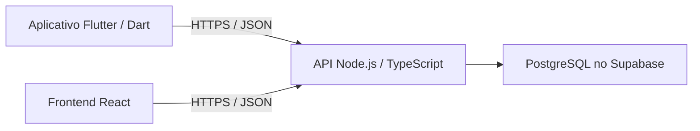

# Detalhamento do projeto Hackarum-Yvisalro

**Data da análise:** 13/11/2026.
**Base local:** branch `docs/detalhamento-frontend`, commit `bbbda4a`, antes do commit desta revisão.
**Verificação no GitHub:** `main` e `docs/detalhamento-frontend` em `bbbda4a`; `VictorXavierSL-patch-1-dev` em `8bcbfeb`, incluindo `e3d5af5`. As mudanças remotas consultadas não foram integradas como histórico nesta revisão. Consulte o [relatório de conformidade](revisao-conformidade.md).

Este documento reúne o que existe, o comportamento planejado e as decisões pendentes. Ele complementa o [planejamento](../README.md), a [especificação](../specs/001-vitrine-perto/spec.md) e o [detalhamento das telas](frontend.md). As sugestões de sequência abaixo servem para organizar o trabalho; as funcionalidades descritas continuam dependentes de implementação.

## Objetivo e público

O projeto propõe uma vitrine para web e aplicativo móvel que ajude consumidores a encontrar produtos e promoções em lojas de um shopping. A pessoa pesquisa um produto, compara ofertas, identifica a loja e consulta um trajeto interno simulado.

Há dois públicos principais:

- **Consumidor:** procura produtos, compara preços, salva desejos e localiza lojas.
- **Representante de empresa:** publica e atualiza o catálogo da própria empresa, incluindo preço, promoções e disponibilidade.

O MVP não inclui compra nem pagamento dentro do aplicativo. A presença de uma oferta depende de cadastro; o sistema deve informar quando não encontra um produto. Shopping, lojas, preços e caminhos da demonstração serão fictícios. A obtenção da localização do dispositivo está prevista como integração real, com alternativa manual.

## O que está pronto e o que ainda falta construir

| Parte | Situação encontrada |
| --- | --- |
| Repositório Git e GitHub | Existem, com histórico de commits, branches e um PR já integrado. |
| Proposta e tecnologias | Documentadas no README. São decisões iniciais. |
| Especificação | Há histórias, requisitos, cenários e critérios de sucesso; o documento está em rascunho com pendências. |
| Protótipo visual | Há 11 imagens de telas de consumidor e explicação de comportamento. |
| Organização do protótipo | Há uma atualização na branch do Victor que renomeia a pasta das imagens e acrescenta um índice com rastreabilidade. Ainda não faz parte da `main` verificada. |
| Ferramentas de planejamento | O Spec Kit tem scripts PowerShell, templates, integrações e habilidades locais. |
| Constituição | O arquivo ainda contém o modelo com campos a preencher; não estabelece princípios aprovados. |
| Plano e tarefas da feature | Não foram encontrados `specs/001-vitrine-perto/plan.md` nem `tasks.md`. Os templates existentes são modelos para produzir esses artefatos. |
| Aplicação Flutter, frontend web e painel empresarial | Ainda não implementados no repositório analisado. |
| Backend e integrações | Não há API da aplicação nem configuração funcional dos serviços no material analisado. |
| Banco e autenticação | PostgreSQL principal no Supabase e Supabase Auth previstos; MySQL somente alternativa documentada. Nada integrado ainda. |
| Testes e publicação da aplicação | Ainda não há testes da aplicação nem implantação configurada no repositório. |

As imagens mostram a aparência desejada. Elas não executam login, busca, cadastro ou rotas. Os scripts PowerShell existentes apoiam a organização do projeto; não são o backend do aplicativo.

## Nomes que aparecem nos documentos

O nome atual foi padronizado como **Hackarum-Yvisalro** nos documentos. **Vitrine Perto** permanece no caminho histórico `specs/001-vitrine-perto`; **Achei** continua impresso nas imagens e no caminho local dessas imagens. A branch do Victor usa `hackarum-yvisalro-telasprototipo`. O repositório mantém **HackaRun** no endereço.

Os nomes antigos são referências históricas do mesmo projeto. As imagens não foram redesenhadas e o endereço do GitHub foi preservado. Shopping Aurora no protótipo e Shopping Veredas Douradas nos exemplos são fictícios; a equipe deverá escolher um conjunto consistente de dados na implementação.

## Funcionalidades e regras principais

| Módulo | Comportamento previsto | Referência |
| --- | --- | --- |
| Conta | Cadastro com nome, email, senha e foto opcional; autenticação real, recuperação por email e entrada por Google/Apple. | História 2; FR-001 |
| Preferências e desejos | Salvar interesses e itens desejados por conta, com sincronização entre dispositivos e escolha de comunicação. | História 2; FR-002 e FR-010 |
| Busca | Consultar nomes, categorias e sinônimos, usar filtros e receber ajuda para erros de digitação. | História 1; FR-003 |
| Resultados e comparação | Mostrar loja, preço e disponibilidade; distinguir variantes relacionadas de ofertas equivalentes. | História 1; FR-004 e FR-005 |
| Empresa | Criar conta e publicar imediatamente; administrar somente os dados das empresas às quais o representante está autorizado. | História 4; FR-006 |
| Shopping e mapa | Selecionar shopping com geolocalização ou manualmente; consultar mapa fictício, lista de lojas e rota simulada. | História 3; FR-007 e FR-008 |
| Promoções e alertas | Exibir dados disponíveis da oferta; enviar alertas solicitados por email e separar consentimento promocional. | História 5; FR-009 e FR-010 |
| Recomendações e stories | Mostrar conteúdo com base nos interesses e interações disponíveis. | História 5; FR-011 |
| Evoluções | Listas por shopping, roteiro de várias lojas, preço por unidade, histórico e compartilhamento. | História 6; FR-012 |
| Apresentação e plataformas | Criar landing pages com conteúdos diferentes e experiência web e móvel. | História 6; FR-013 e FR-014 |

### Busca e comparação

A ordenação definida é: produtos disponíveis por relevância à busca; entre resultados semelhantes, menor preço; itens sem estoque por último. Resultados relacionados, como versões de cores diferentes, não se tornam automaticamente o mesmo produto para comparação.

Cada oferta precisa identificar a loja e sua disponibilidade. Sem correspondência, a interface informa que não encontrou resultados e permite ajustar a busca ou os filtros. O cálculo de relevância e o critério exato de equivalência entre variantes ainda precisam ser especificados.

### Localização e rota

A localização do dispositivo serve para apoiar a descoberta. O caminho interno será representado em um mapa fictício, a partir de um ponto inicial escolhido pela pessoa. A proposta não estabelece rastreamento real da posição dentro do shopping.

Quando a localização não puder ser obtida, a mensagem definida é “Não foi possível encontrar a localização do dispositivo”, acompanhada da seleção manual do shopping. Deve existir uma lista textual de lojas como alternativa ao mapa. Durante uma rota ativa, os pop-ups de promoções próximas ficam suspensos.

### Conta, comunicação e empresas

Desejos e preferências acompanham a conta entre dispositivos. Alertas solicitados devem ser enviados por email quando houver reposição ou quando o preço desejado for atingido, conforme as preferências. Publicidade por email exige escolha separada; a frequência promocional continua pendente.

Qualquer empresa poderá criar conta e começar a publicar sem aprovação prévia. Isso exige controle de acesso: um representante não pode administrar produtos de outra empresa sem autorização. A política de associação entre representantes e empresas ainda precisa de detalhamento.

## As 11 telas do protótipo

| Tela | Papel no fluxo |
| --- | --- |
| 01 — Login | Entrar, trocar conta, usar preenchimento de senha ou seguir para cadastro e recuperação. |
| 02 — Cadastro | Coletar nome, email, senha e foto opcional. |
| 03 — Preferências | Escolher interesses, produtos desejados e recebimento de publicidade. |
| 04 — Recuperação de senha | Solicitar recuperação por email e representar confirmação por código. O fluxo completo depende do contrato de autenticação. |
| 05 — Início | Exibir busca, categorias, atalhos, stories e ofertas. |
| 06 — Resultados | Apresentar filtros, ofertas, lojas, preços e disponibilidade. |
| 07 — Story promocional | Mostrar uma oferta e oferecer acesso ao trajeto e aos desejos. |
| 08 — Desejos e alertas | Consultar itens salvos e pedidos de aviso. |
| 09 — Mapa | Localizar lojas, consultar pisos e escolher um destino. |
| 10 — Rota ativa | Mostrar o trajeto e manter anúncios próximos suspensos. |
| 11 — Oferta próxima | Apresentar promoção sobre a tela inicial quando as condições permitirem. |

Os detalhes de cada ação estão em [frontend.md](frontend.md). Ainda faltam desenhos para o painel da empresa, entradas de Google/Apple, seleção manual e erro de localização, lista textual de lojas, ponto inicial da rota, perfil, notificações e landing pages. Também faltam estados de carregamento, falha, ausência de conexão e busca vazia.

## Arquitetura e tecnologias previstas

| Parte | Escolha registrada | O que precisa ser detalhado |
| --- | --- | --- |
| Aplicativo | Flutter e Dart, com MVVM. | Estrutura de módulos, navegação, estado e contratos de dados. |
| Experiência web | React; TypeScript proposto. MVVM com componentes como Views e hooks ou módulos de estado como ViewModels. | Navegação, contratos e separação entre consumidor e painel empresarial. |
| Backend | Node.js com TypeScript e comunicação HTTPS/JSON. | Framework, endpoints, validações, autorização e hospedagem. |
| Dados | PostgreSQL no Supabase. | Esquema, relacionamentos, migrações e regras de acesso. |
| Alternativa de dados | MySQL somente documentado para avaliação futura, conforme opção A aceita pela equipe. | Sem instância operacional, réplica ou escrita dupla no MVP. |
| Identidade | Supabase Auth. | Fluxos de sessão, recuperação, Google/Apple e integração com a API. |
| Mapa | Representação interna fictícia com aparência 3D. | Tecnologia de desenho, pontos, conexões, andares e algoritmo do trajeto. |
| Emails | Alertas solicitados e publicidade conforme preferências. | Serviço de envio, processamento, prevenção de avisos repetidos e frequência promocional. |
| Landing pages | Slides no Canva, como apresentação da tecnologia sorteada. | Produzir os slides a partir do roteiro para consumidor e lojista; confirmar quantidade final e eventual exigência de site. |

O fluxo proposto para os dados da aplicação é:

Na organização MVVM, a tela apresenta conteúdo e recebe ações; o view model mantém o estado e coordena o comportamento; a camada de dados acessa os serviços. O contrato técnico ainda deve estabelecer como a autenticação e as interfaces web se conectam a esse fluxo.

GitHub hospeda o repositório e o histórico. Supabase está previsto para dados e identidade. Canva é a ferramenta escolhida para os slides; Vercel deixou de ser premissa das apresentações. Hospedagem da interface React e da API será definida posteriormente. A presença dos documentos no GitHub não comprova integração ou implantação.

MVVM organiza as interfaces Flutter e React. A API mantém camadas de entrada, serviços e repositórios de dados. Ambas as interfaces usarão a mesma API; o fluxo de identidade proposto é cliente → Supabase Auth → token → API, que valida a sessão e o acesso aos dados de cada empresa. Credenciais do banco permanecem no servidor. O [diagrama no README](../README.md#arquitetura-proposta) registra essas responsabilidades.

## Dados do produto

O modelo abaixo é conceitual. Não representa tabelas ou endpoints já criados.

| Grupo | Informações previstas |
| --- | --- |
| Usuário e preferências | Identidade, nome, foto opcional, interesses e escolhas de comunicação. |
| Empresa e representante | Empresa, pessoas autorizadas e vínculo de acesso ao catálogo. |
| Shopping e loja | Shopping fictício, identificação da loja, andar e posição no mapa. |
| Produto e categoria | Descrição, categoria, variantes e termos relacionados à busca. |
| Oferta | Relação entre produto e loja, preço, disponibilidade, desconto e vigência. |
| Desejos, listas e alertas | Produtos de interesse por conta, shopping, preço desejado e condição de aviso. |
| Mapa e rota | Pontos, conexões, andares e trajetos fictícios. |
| Histórico de preços | Valores e datas quando a evolução for implementada e houver dados. |

Separar produto de oferta permite representar um mesmo produto vendido em lojas diferentes. A regra que identifica quando dois cadastros representam o mesmo produto ainda precisa ser definida.

## Atualizações consultadas na branch do Victor

O commit `e3d5af5` reorganiza as 11 imagens de `docs/imagens/achei/` para `docs/imagens/hackarum-yvisalro-telasprototipo/`, ajusta as referências e cria `specs/001-vitrine-perto/prototipo/README.md`. As imagens foram identificadas pelo Git como renomeações com conteúdo preservado.

O commit posterior `8bcbfeb` registra o tema 03, landing page como tecnologia sorteada e TypeScript no backend. Essas definições documentais foram consideradas nesta revisão. A reorganização das imagens e o índice de protótipos continuam na branch de origem; esta consulta não fez merge.

O [índice do protótipo nessa versão](https://github.com/leonardodavi9274-byte/HackaRun-2026-projeto-Yvisalro-13-/blob/e3d5af5c08f85395d150bd46a4c6f86f669d798a/specs/001-vitrine-perto/prototipo/README.md) registra lacunas e divergências que devem ser conferidas na revisão visual:

- Uma oferta de R$ 299 por R$ 229 tem redução de aproximadamente 23,4%, mas algumas telas indicam 25%.
- A indicação textual de curva e a seta da rota apontam direções diferentes.
- O rótulo de ordenação da busca não expressa a prioridade de relevância definida na especificação.
- O login admite nome de usuário ou email, enquanto o cadastro só coleta email.
- A ação “Reservar item” aparece no protótipo, mas sua inclusão no MVP ainda depende de decisão.

Esses apontamentos vieram da documentação dessa branch; esta análise não realizou uma nova inspeção visual das imagens. A integração do histórico dessa branch deve ser revisada separadamente para passar a compor a `main`.

## Pendências que afetam o início da implementação

1. **Recorte da entrega:** definir o que cabe no primeiro MVP e o que fica como evolução. As Histórias 1 a 4 são P1; a História 5 é P2, e a História 6 reúne P2/P3. As 14 ideias do README não são todas obrigatórias no primeiro recorte.
2. **Demonstração:** usar Hackarum-Yvisalro nos materiais novos e alinhar os nomes fictícios e coordenadas. As imagens antigas ainda exibem Achei.
3. **Catálogo:** definir equivalência de produtos, variantes e cálculo de relevância.
4. **Empresas:** detalhar vínculo de representantes e permissões de administração.
5. **Conta:** fechar validações, confirmação, recuperação e configuração de Google/Apple.
6. **Comunicação:** detalhar envio de alertas, frequência promocional e comportamento em falhas de email.
7. **UX:** completar as telas ausentes e decidir sobre a ação de reserva.
8. **Entrega acadêmica:** revisar os roteiros de consumidor e lojista, produzir slides no Canva e conferir se a disciplina exige site publicado. Landing page já foi identificada como tecnologia sorteada.
9. **Operação:** definir cronograma, responsáveis por execução, hospedagem do backend e limites dos serviços.
10. **Planejamento técnico:** preencher os princípios do projeto e produzir plano, modelo de dados, contratos e tarefas da feature.

A informação antiga de que não havia repositório foi corrigida na especificação. A [feature 002](../specs/002-planejamento-hackarum-yvisalro/spec.md) registra a revisão da entrega e a decisão de usar PostgreSQL como principal e MySQL somente como alternativa.

## Ordem sugerida para continuar

| Etapa | Resultado esperado |
| --- | --- |
| 1. Organizar o trabalho da equipe | Atualizar a base de trabalho e revisar as mudanças separadas em branches. |
| 2. Fechar as decisões de produto | Recorte do MVP, nomes, regras de catálogo, empresas e comunicação. |
| 3. Completar os fluxos visuais | Telas ausentes, estados de falha e correções do protótipo. |
| 4. Produzir o plano técnico | Princípios aprovados, modelo de dados, contratos da API e estratégia de autenticação. |
| 5. Gerar e revisar tarefas | Tarefas por história, com dependências e critérios de aceite. |
| 6. Implementar um fluxo completo | Por exemplo: empresa publica uma oferta e consumidor consegue encontrá-la na busca, com autorização e dados persistidos. |
| 7. Completar o recorte e validar | Conta, desejos, mapa, alertas e demais funcionalidades aprovadas para a entrega. |
| 8. Publicar e demonstrar | Configurar os serviços e apresentar o sistema com dados fictícios identificados. |

Essa sequência é uma recomendação de organização, não um plano de implementação já aprovado ou executado.

## Como verificar se o futuro MVP funciona

A especificação já define seis critérios de sucesso. Eles ainda precisarão ser executados contra a aplicação implementada:

- Buscas de referência encontram os produtos cadastrados e identificam as lojas.
- Itens sem estoque aparecem depois dos disponíveis e informam seu estado.
- Desejos e preferências aparecem em outra sessão da mesma conta após sincronização.
- Pop-ups de promoções próximas ficam suspensos durante rota ativa.
- Uma empresa consegue administrar seu catálogo, enquanto outra não consegue alterá-lo.
- Buscas vazias informam a ausência de resultado e permitem ajustar a consulta.

## Onde consultar cada assunto

| Arquivo ou pasta | Conteúdo |
| --- | --- |
| [README](../README.md) | Proposta, funcionalidades, tecnologias e ideias priorizadas. |
| [Frontend](frontend.md) | As 11 telas, ações, navegação e pontos em aberto. |
| [Especificação](../specs/001-vitrine-perto/spec.md) | Histórias, requisitos, regras e critérios de sucesso. |
| [Checklist](../specs/001-vitrine-perto/checklists/requirements.md) | Itens de qualidade e decisões ainda pendentes. |
| [Entrega e próximos passos](entrega-e-proximos-passos.md) | Organização da entrega e pendências da equipe. |
| [Guia de Git](guia-git.md) | Como atualizar o computador, enviar commits e integrar branches. |
| [Configuração do Spec Kit](../.specify/) | Scripts, templates, integrações e memória de planejamento. |
