# Hackarum-Yvisalro — proposta e estrutura inicial das telas

O Hackarum-Yvisalro é uma vitrine para quem está no shopping. A pessoa pode procurar um produto, comparar ofertas de lojas, acompanhar itens de interesse e visualizar o caminho até uma loja. O **Shopping Aurora**, as lojas, os preços e os trajetos das imagens são demonstrativos. **Achei** é o nome ainda impresso nas imagens antigas; **Vitrine Perto** aparece no caminho da especificação histórica. Ambos se referem ao mesmo projeto; as imagens não foram redesenhadas nesta revisão.

**Estado do projeto.** Já existem o protótipo visual com 11 imagens, o planejamento e a especificação. A base React em `frontend/` tem uma página inicial e consulta o estado da WebAPI, conforme a [feature 003](../specs/003-base-webapi-frontend/plan.md). As telas 02/03, a entrada mínima e os estados de conta têm código implementado na feature 004; dependem de configuração real do Supabase. As demais telas e integrações continuam planejadas. Cada imagem é acompanhada das ações esperadas e dos pontos que precisam ser decididos antes da implementação.

**Protótipo confirmado em 13/11/2026.** As 11 telas permanecem no canvas de design atual. As imagens exportadas neste documento continuam como referência de UX para a implementação em React na web. O formato das landing pages será definido separadamente.

**Cadastro e preferências detalhados.** A [feature 004](../specs/004-cadastro-preferencias/spec.md) especifica as telas 02 e 03, as regras dos campos, a foto opcional, os interesses, o consentimento promocional e a integração funcional entre frontend e backend. Ela registra as adequações necessárias às imagens, incluindo publicidade desligada inicialmente. O código desses fluxos está implementado; a configuração externa e a execução funcional ainda estão pendentes.

## Decisões recentes para o frontend

- **Plataformas:** React confirmado para a interface web e o painel empresarial; Flutter/Dart para o aplicativo móvel. MVVM separará apresentação, estado e dados. TypeScript confirmado para o backend Node.js e proposto para React; os contratos serão detalhados no plano técnico.
- **Acesso da empresa:** além das telas de consumidor mostradas no protótipo, será necessário desenhar o painel da empresa. Qualquer empresa poderá criar sua conta e publicar imediatamente; cada empresa deverá ter acesso de gestão apenas aos próprios dados.
- **Busca:** os resultados disponíveis devem aparecer por relevância ao termo pesquisado e, entre semelhantes, pelo menor preço. Os esgotados ficam por último. Variações semelhantes, como cores diferentes, não são automaticamente o mesmo produto.
- **Localização:** se não for possível obter a localização do dispositivo, mostrar a mensagem “Não foi possível encontrar a localização do dispositivo” e oferecer a escolha manual do shopping. No trajeto interno simulado, a pessoa escolhe um ponto inicial conhecido.
- **Conta e alertas:** desejos e preferências acompanham a conta entre dispositivos. Os alertas solicitados são previstos por email quando houver reposição ou quando o preço desejado for atingido, conforme as preferências do usuário.
- **Dados:** PostgreSQL no Supabase confirmado como banco do MVP; integração ainda pendente.
- **Páginas de apresentação:** formato, ferramenta, quantidade e finalidades ainda serão definidos. Há um [rascunho de roteiro em slides do Canva para consumidores e lojistas](landing-pages-canva.md).

Estas decisões descrevem o comportamento esperado. O painel empresarial e os pontos de acesso às opções de login Google e Apple ainda precisam de telas próprias no protótipo.

## Visão geral da navegação

| A pessoa quer… | Caminho previsto |
| --- | --- |
| Entrar ou criar uma conta | **Login → Início**. Para uma conta nova, **Login → Cadastro → Preferências → Início**. |
| Recuperar a senha | **Login → Recuperação por e-mail → confirmação do código e redefinição da senha**. O retorno após a redefinição ainda precisa ser definido. |
| Encontrar e comparar um produto | **Início ou aba Buscar → Resultados da busca → oferta de uma loja → rota no mapa**, se a pessoa escolher ir até lá. |
| Descobrir uma promoção | **Início → Story da loja**. Uma oferta de proximidade também pode aparecer sobre o Início. |
| Acompanhar um produto | **Story → salvar nos Desejos** ou **Busca → pedir aviso de reposição → Avise-me**. |
| Localizar uma loja | **Aba Mapa → buscar no mapa ou consultar lojas próximas**. O ponto inicial e o destino fazem parte do fluxo de rota previsto. |

A barra inferior aparece nas imagens de **Início**, **Buscar**, **Desejos** e **Mapa**. **Perfil** aparece como atalho, com conteúdo ainda a definir. O sino do Início também aparece sem uma tela de destino representada.

## Telas e estados do protótipo

### 01 — Login

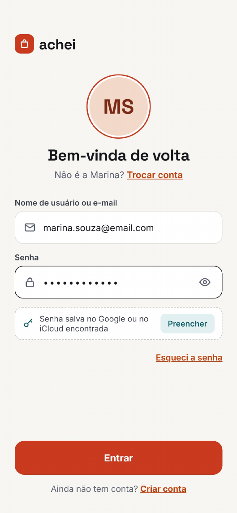

**Objetivo.** Dar acesso à conta e oferecer caminhos para quem precisa se cadastrar, trocar de conta ou recuperar a senha.

**O que a imagem mostra.** A interface reconhece uma conta de exemplo e exibe as iniciais e o e-mail. O campo aceita “Nome de usuário ou e-mail”, a senha fica oculta e o ícone de olho permite alternar sua visibilidade. O cartão **Preencher** representa uma senha salva no Google ou no iCloud.

**Como deve funcionar**

- **Entrar** valida os campos e inicia a autenticação. Após a confirmação, a pessoa chega ao Início com a sessão da conta correta.
- **Trocar conta** permite informar outras credenciais. **Preencher** solicita o preenchimento pelo gerenciador de senhas quando disponível no dispositivo. A pessoa também pode preencher os campos manualmente.
- **Esqueci a senha** leva à imagem 04. **Criar conta** leva à imagem 02.
- Se as credenciais forem inválidas ou a conexão falhar, a tela informa o problema e permite tentar novamente.

**Cadastro detalhado e pontos restantes.** A feature 004 não cria nome de usuário separado; o e-mail identifica a conta no cadastro. O rótulo de entrada da imagem 01 deverá ser alinhado a essa regra quando o login for implementado. A escolha da conta lembrada e os pontos de acesso para Google e Apple continuam a definir, fora desse recorte.

### 02 — Cadastro · dados da conta

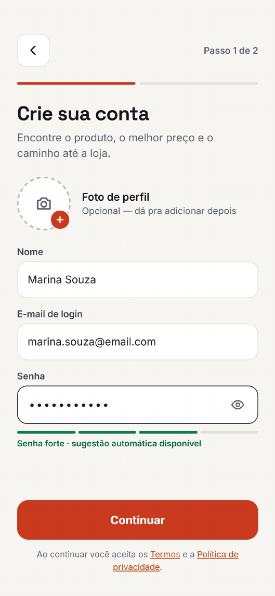

**Objetivo.** Coletar os dados essenciais da conta antes da personalização do aplicativo.

**O que a imagem mostra.** A indicação **Passo 1 de 2** acompanha o formulário de nome, e-mail e senha. Há um espaço para foto de perfil opcional, um indicador de força da senha, uma referência à sugestão automática de senha e links para os Termos e a Política de Privacidade.

**Como deve funcionar**

- Permitir seguir com ou sem foto. A pessoa pode mostrar ou ocultar a senha durante o preenchimento.
- **Continuar** verifica os dados obrigatórios e abre Preferências (imagem 03) quando os dados passam na validação.
- Campos inválidos recebem uma indicação que ajude a corrigir o problema. Ao voltar da segunda etapa, os dados já preenchidos devem ser preservados durante o cadastro.

**Regras especificadas.** A feature 004 define validação de nome/e-mail/senha, tratamento de conta existente, criação somente ao concluir ou pular o passo 2, confirmação de e-mail, limites da foto e retomada de falhas. O plano técnico deve definir o armazenamento e os contratos de integração; os destinos reais dos documentos legais são dependência para liberar o cadastro.

### 03 — Cadastro · preferências

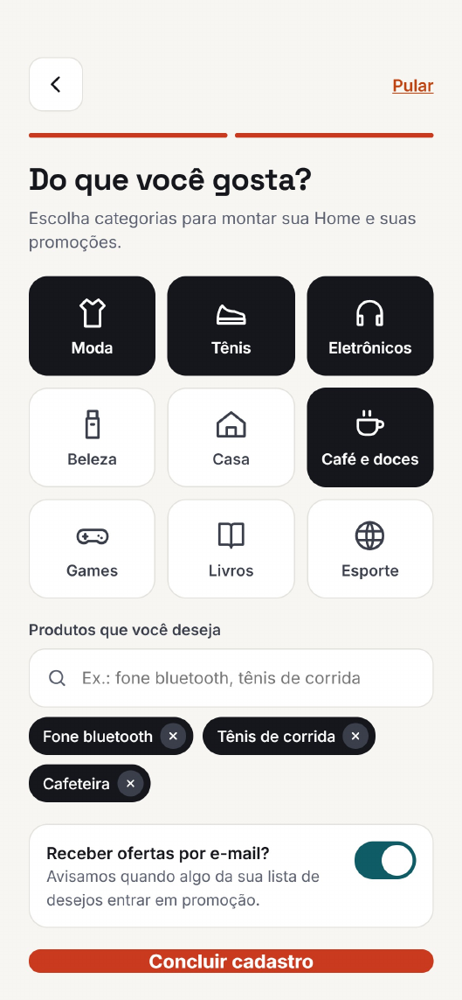

**Objetivo.** Personalizar as recomendações do Início e registrar a escolha sobre ofertas por e-mail.

**O que a imagem mostra.** Categorias como Moda, Tênis e Eletrônicos aparecem em uma grade. O campo de produtos desejados tem itens adicionados em etiquetas removíveis. O controle de e-mail, o botão **Concluir cadastro** e a ação **Pular** completam a tela.

**Como deve funcionar**

- Selecionar ou desmarcar várias categorias e adicionar ou remover produtos de interesse.
- Registrar a escolha sobre e-mails promocionais separadamente das categorias e dos produtos desejados.
- **Concluir cadastro** salva as preferências e segue para o Início quando o cadastro é confirmado. **Pular** permite seguir sem preencher essa etapa.
- As preferências salvas devem acompanhar a conta. Quando estiverem vazias, o Início precisa ter conteúdo que a pessoa possa explorar.

**Regras especificadas.** Na feature 004, os produtos digitados são termos livres de interesse e não criam Desejos ou alertas; categorias e publicidade começam sem seleção. **Pular** conclui sem interesses e sem publicidade, preservando a foto do passo 1 quando houver. Sem preferências, a pessoa pode explorar categorias; o algoritmo de recomendação fica fora desse recorte. O texto promocional da imagem deve ser ajustado para não misturar publicidade com alertas solicitados.

### 04 — Recuperação de senha

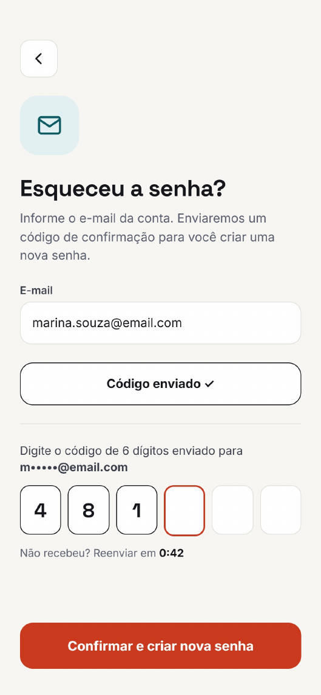

**Objetivo.** Permitir que a pessoa volte a acessar a conta mediante confirmação por e-mail.

**O que a imagem mostra.** O campo de e-mail e a indicação **Código enviado** aparecem acima de seis campos numéricos. O endereço de destino é parcialmente ocultado na instrução de confirmação. A contagem indica quando o reenvio fica disponível.

**Como deve funcionar**

- Solicitar o envio do código e confirmar na interface quando a solicitação for concluída.
- Receber os seis dígitos e disponibilizar o reenvio conforme o prazo definido. Se o código estiver incorreto ou expirado, orientar a pessoa a corrigir ou pedir outro.
- **Confirmar e criar nova senha** valida o código e dá continuidade à redefinição. A imagem termina antes da etapa em que a nova senha é digitada.

**A definir.** Expiração e reenvio do código, formato da etapa de nova senha e destino após a redefinição.

### 05 — Início

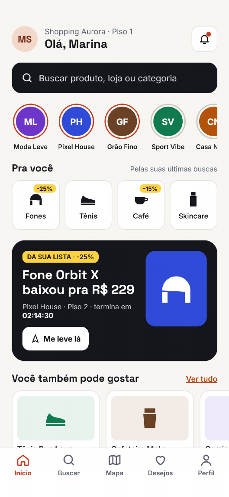

**Objetivo.** Ser o ponto de partida para procurar um produto ou descobrir ofertas no shopping.

**O que a imagem mostra.** O cabeçalho informa o shopping e o piso, cumprimenta a pessoa e exibe um sino. Abaixo estão o campo de busca, os atalhos circulares das lojas, as categorias em **Pra você**, uma oferta destacada com tempo restante e o carrossel **Você também pode gostar**.

**Como deve funcionar**

- A busca aceita produtos, lojas e categorias e leva aos resultados. Os atalhos circulares levam aos stories da loja correspondente.
- Recomendações podem usar interesses e interações disponíveis, como buscas recentes. Ofertas exibem preço, loja, piso e validade quando esses dados existirem.
- **Me leve lá** usa a loja da oferta destacada como destino. A barra inferior permite mudar de área sem precisar voltar ao login.
- Prever conteúdo para contas novas e mensagens para falhas de carregamento do catálogo.

**A definir.** Destinos de **Ver tudo** e do sino, regra de personalização e tratamento de uma oferta que expira enquanto aparece na tela.

### 06 — Resultados da busca

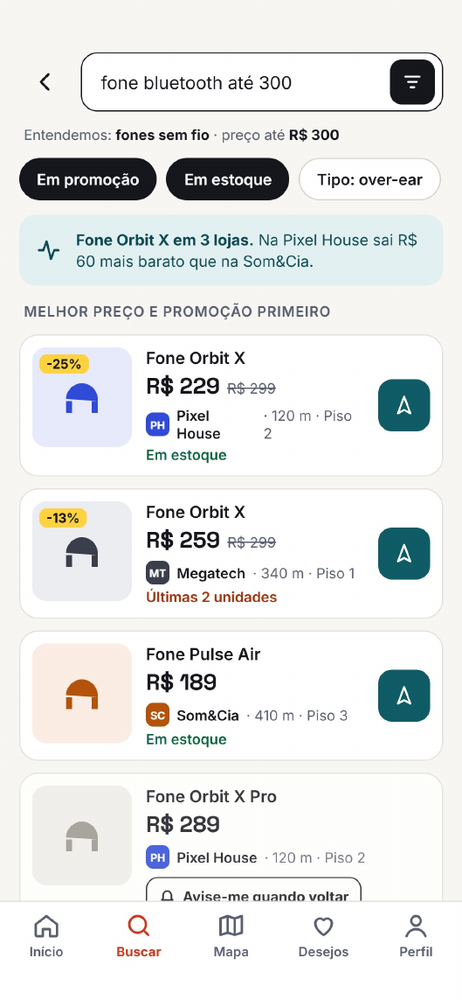

**Objetivo.** Ajudar a decidir onde encontrar o produto pesquisado e qual oferta vale consultar.

**O que a imagem mostra.** A consulta “fone bluetooth até 300” é interpretada como “fones sem fio” com limite de R$ 300. Há filtros de promoção, estoque e tipo, um resumo de comparação e cartões com produto, loja, preço, piso, distância e situação do estoque.

**Como deve funcionar**

- Mostrar como a busca foi interpretada e permitir editar a consulta e os filtros. Se não houver resultados, informar isso e permitir ajustar os termos.
- Comparar preços de ofertas do mesmo produto, respeitando as variantes. Produtos parecidos podem aparecer como alternativas. A loja deve estar identificada em cada resultado.
- Ordenar os itens disponíveis por relevância e, entre semelhantes, por menor preço, conforme a especificação. Itens sem estoque vêm depois dos disponíveis. O rótulo **Melhor preço e promoção primeiro** do protótipo precisa refletir a regra escolhida.
- O botão de rota usa a loja do cartão escolhido. **Avise-me quando voltar** registra o pedido de reposição para o item conforme a regra de alerta definida.

**A definir.** Critério de equivalência entre variantes, combinação dos filtros, como a distância será calculada e se o alerta de reposição vale para a oferta daquela loja ou para o produto em qualquer loja.

### 07 — Story promocional

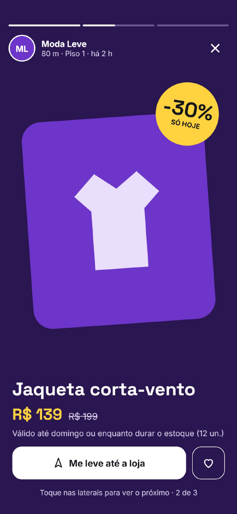

**Objetivo.** Apresentar uma oferta em tela cheia e permitir agir sobre ela imediatamente.

**O que a imagem mostra.** O cabeçalho exibe loja, piso, distância e tempo desde a publicação. Barras de progresso indicam a posição na sequência. A oferta inclui produto, preço atual, preço anterior, desconto e condição de validade ou estoque.

**Como deve funcionar**

- Abrir a sequência a partir do atalho de uma loja no Início. Usar as laterais da tela para mudar de story e o botão de fechar para voltar.
- O coração salva o produto nos Desejos. O estado visual precisa indicar se o item foi salvo.
- **Me leve até a loja** abre o fluxo de rota usando a loja da oferta como destino.
- O preço, o desconto e a validade devem representar a mesma oferta. Caso o dado esteja vencido ou indisponível, a interface deve informar a condição.

**A definir.** Reprodução automática, duração dos stories e comportamento do botão de rota quando uma oferta vence.

### 08 — Desejos e alertas

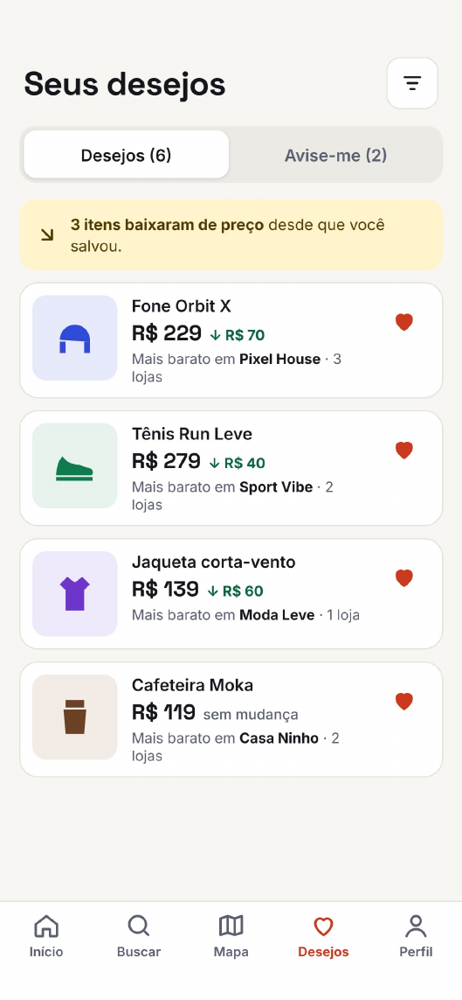

**Objetivo.** Reunir produtos salvos e facilitar o acompanhamento de preço e disponibilidade.

**O que a imagem mostra.** A aba **Desejos** está selecionada. Os cartões exibem preço, variação, loja mais barata e número de lojas. A faixa superior informa quantos itens baixaram de preço. **Avise-me** aparece como segunda aba e o ícone de filtro fica no cabeçalho.

**Como deve funcionar**

- Exibir os produtos salvos e permitir removê-los pelo coração. A lista deve acompanhar a conta entre dispositivos.
- Mostrar a melhor oferta conhecida e a variação em relação ao preço de referência. A mensagem de queda deve refletir os itens da lista.
- **Avise-me** reúne os pedidos de alerta. A especificação prevê avisos por e-mail quando houver reposição ou quando o preço desejado for atingido, conforme as preferências da conta.
- Prever uma mensagem quando a lista ou os alertas estiverem vazios e uma opção para tentar novamente em caso de falha de sincronização.

**A definir.** Conteúdo da aba **Avise-me**, configuração de preço-alvo, filtros, cancelamento de pedidos de alerta e preço de referência para calcular a queda.

### 09 — Mapa do shopping

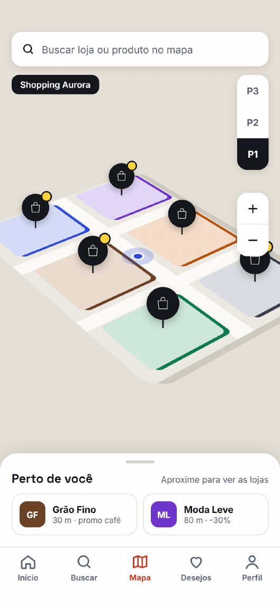

**Objetivo.** Localizar lojas dentro do shopping e orientar a escolha de um destino.

**O que a imagem mostra.** O mapa tem aparência 3D, busca por loja ou produto, marcadores, controles de zoom e seletor de pisos **P1**, **P2** e **P3**. O painel **Perto de você** mostra exemplos de lojas próximas com distância e oferta.

**Como deve funcionar**

- Alternar pisos e atualizar os marcadores e as lojas correspondentes. Ao aproximar o mapa, os ícones podem passar a mostrar os logotipos das lojas quando estiverem disponíveis.
- Permitir buscar uma loja ou produto e identificar a loja correspondente. A especificação também prevê uma lista textual por piso e categoria como alternativa para consultar as lojas.
- Usar a geolocalização do dispositivo para apoiar a descoberta do shopping. Se a localização estiver indisponível, informar o problema e oferecer seleção manual conforme a especificação.
- Para iniciar um trajeto, usar um ponto inicial escolhido no mapa e a loja selecionada como destino. O mapa interno e o percurso são simulados.

**A definir.** Dados do mapa, coordenadas de demonstração, regra da lista de proximidade e como selecionar o ponto de partida. O ponto azul da imagem representa uma posição no mapa do protótipo.

### 10 — Rota ativa

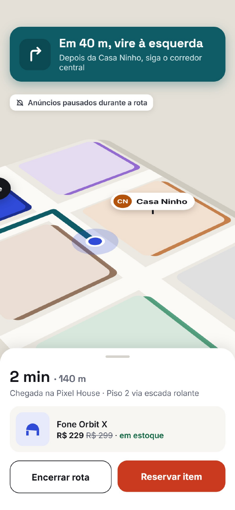

**Objetivo.** Manter as instruções do trajeto visíveis enquanto a pessoa segue até a loja.

**O que a imagem mostra.** Um traçado liga a posição indicada ao destino. A faixa superior exibe a próxima instrução e o aviso de anúncios pausados. O painel inferior apresenta tempo, distância, piso de chegada, produto, preço e estoque. Os botões são **Encerrar rota** e **Reservar item**.

**Como deve funcionar**

- Exibir a próxima instrução e atualizar o resumo de distância e tempo de acordo com a simulação. Indicar a troca de piso quando fizer parte do trajeto.
- Manter seta, texto e traçado coerentes. Nesta imagem, o texto orienta virar à esquerda e a seta aponta à direita. Esse detalhe precisa ser corrigido no protótipo.
- **Encerrar rota** finaliza o trajeto e devolve a navegação ao mapa. Enquanto houver rota ativa, as ofertas de proximidade ficam suspensas.
- A ação **Reservar item** depende de uma definição de escopo e de confirmação de disponibilidade. O escopo atual da vitrine deixa compras e pagamentos fora do aplicativo.

**A definir.** Como detectar a chegada na simulação, como lidar com troca de destino e se a reserva entra no MVP. Se entrar, é preciso decidir como a loja confirma o pedido, por quanto tempo guarda o item e o que acontece se o estoque acabar.

### 11 — Oferta próxima sobre o Início

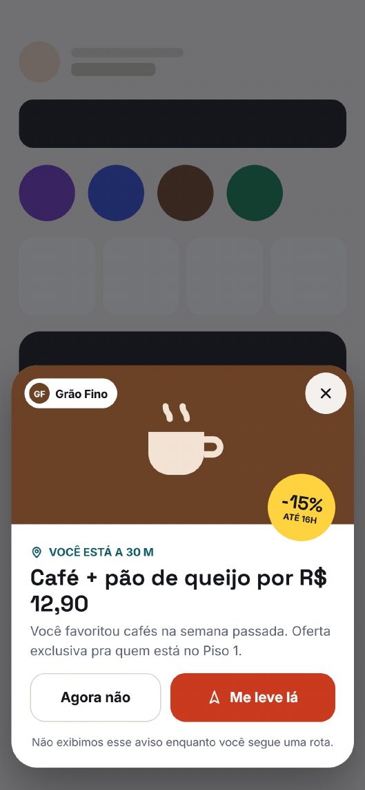

**Objetivo.** Dar visibilidade a uma promoção relevante que pode ser aproveitada em uma loja próxima.

**O que a imagem mostra.** A oferta aparece sobre o Início e combina distância, produto, preço, prazo e uma explicação da recomendação. A pessoa pode usar **Agora não**, fechar no **X** ou tocar em **Me leve lá**. O rodapé informa que o aviso fica suspenso durante uma rota.

**Como deve funcionar**

- Exibir a oferta conforme a disponibilidade, a vigência e os critérios de proximidade e interesse. No exemplo, a oferta é do Grão Fino, no mesmo piso, e a interface relaciona a sugestão a um interesse anterior em cafés.
- Fechar a oferta devolve a pessoa ao Início. **Me leve lá** inicia o fluxo de rota com o Grão Fino como destino no exemplo.
- O sistema verifica se há uma rota ativa antes de abrir a oferta. Essa regra vale independentemente de como a rota foi iniciada.

**A definir.** Raio de proximidade, frequência de exibição, período de espera após dispensar uma oferta e fonte do histórico usado na recomendação.

## Como o sistema se organiza

| Área | Responsabilidade | Planejamento atual |
| --- | --- | --- |
| Interface | Apresentar telas, navegação, formulários, filtros, cards e estados como carregamento e erro. | **Flutter/Dart** no app; **React** na web e no painel empresarial. |
| Estado da interface | Controlar ações e estado de cada tela, como busca, seleção de piso, favoritos e rota ativa. | **MVVM**; no React, componentes como Views e hooks ou módulos de estado como ViewModels. |
| API e regras de negócio | Fornecer catálogo, ofertas, disponibilidade, dados do mapa e informações da conta. | **Node.js/TypeScript**, com comunicação HTTPS/JSON. Contratos e hospedagem a definir. |
| Identidade e persistência | Autenticar e armazenar dados de conta, preferências, itens salvos e pedidos de alerta. | **Supabase Auth** e **PostgreSQL** principal. **MySQL** somente alternativa documentada, conforme esclarecimento da equipe. |
| Localização e trajeto | Apoiar a escolha do shopping e representar um percurso até a loja. | Geolocalização do dispositivo prevista. Mapa, pisos e rotas internas simulados. |

Os dados principais são **conta e preferências**, **shopping, piso e loja**, **produto e oferta**, **desejo e pedido de alerta**, e **ponto de partida, destino e rota**. O produto identifica o item. A oferta liga esse item a uma loja com preço, estoque e vigência próprios. Essa relação sustenta a comparação da busca, o preço exibido nos Desejos e o destino dos botões de rota.

## Regras comuns de funcionamento

- **Carregamento e falhas.** Mostrar o andamento de ações como login, busca e envio de código. Quando uma operação falhar, preservar as informações que a pessoa pode corrigir e permitir nova tentativa. Exibir confirmação de envio ou de salvamento após o serviço confirmar a operação.
- **Informações de oferta.** Preço, estoque e vigência pertencem à oferta de uma loja. A busca, os Desejos e a rota devem identificar qual oferta estão exibindo e indicar quando um dado está indisponível.
- **Ações e acessibilidade.** Dar nomes compreensíveis aos ícones de olho, filtro, rota, coração e fechamento. Usar texto junto às cores para distinguir estoque baixo, queda de preço e filtros ativos.
- **Escopo do protótipo.** O detalhamento cobre a experiência do consumidor retratada nas 11 imagens. A especificação geral também prevê web, páginas de apresentação e um painel para empresas, cujo desenho segue em aberto neste material.

## Critérios de demonstração

Estes roteiros descrevem resultados esperados e não foram executados nesta entrega. Não constituem etapa obrigatória de testes; a política sem testes da constituição permanece vigente.

- **Conta e personalização.** Passar pelo cadastro com e sem preferências, testar uma credencial inválida e conferir a recuperação por código.
- **Catálogo e preço.** Buscar um produto com ofertas de várias lojas e conferir a ordem, o estoque e o destino do botão de rota. Revisar a consistência entre preço e desconto. Por exemplo, de R$ 299 para R$ 229 a redução é de cerca de **23%**. O selo das imagens 05 e 06 indica **25%**.
- **Desejos e alertas.** Salvar um item pelo story, encontrá-lo na lista e verificar que um pedido de reposição aparece na área prevista. Conferir se a preferência por e-mail promocional é registrada separadamente.
- **Mapa, rota e oferta.** Alternar pisos, testar a seleção manual de shopping, iniciar a rota a partir de uma oferta e conferir a direção do traçado, a troca de piso e a suspensão dos avisos. Encerrar a rota e verificar o retorno ao mapa.
- **Falhas.** Conferir a interface com catálogo vazio, localização indisponível, conexão interrompida e oferta vencida. A mensagem deve explicar a condição e indicar o que a pessoa pode fazer em seguida.

As telas documentadas correspondem às páginas do PDF **Achei — telas do app**. O [planejamento inicial](../README.md) e a [especificação do produto](../specs/001-vitrine-perto/spec.md) registram as decisões que orientam os comportamentos previstos.

